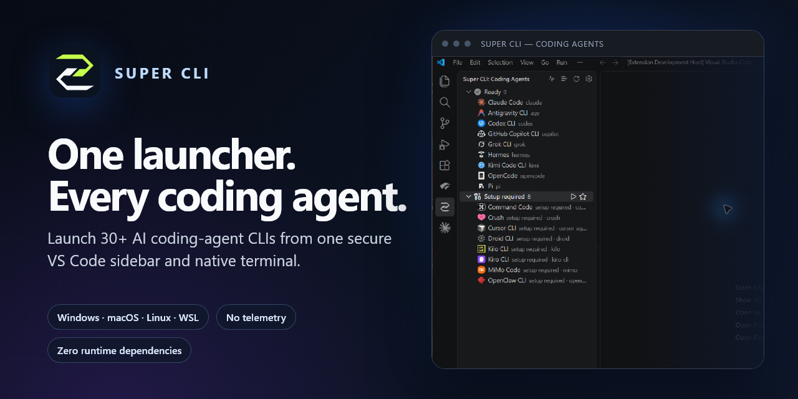
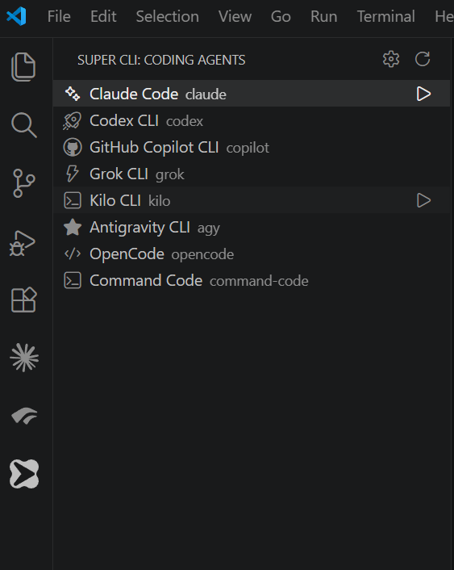

# Super CLI

One launcher. Every coding agent.

[](https://github.com/TheStreamCode/super-cli/actions/workflows/ci.yml)
[](LICENSE)
[](https://marketplace.visualstudio.com/items?itemName=mikesoft.vscode-super-cli)



Launch Claude Code, OpenAI Codex CLI, GitHub Copilot CLI, Google Antigravity, OpenCode, and other AI coding agents inside VS Code from one sidebar and the native integrated terminal. Super CLI keeps every supported agent one click away without replacing its official command-line experience. It works on Windows, macOS, Linux, and WSL, and in any editor that supports the VS Code extension model.

It is free, open source, has zero runtime dependencies, and collects no telemetry.

> **Independent project.** Super CLI is unofficial and is not affiliated with, endorsed by, or sponsored by Anthropic, OpenAI, GitHub, Google, or any other vendor. See the [third-party notices](TRADEMARKS.md).

## Install

Install Super CLI in VS Code from the [Visual Studio Marketplace](https://marketplace.visualstudio.com/items?itemName=mikesoft.vscode-super-cli), or run:

```bash
code --install-extension mikesoft.vscode-super-cli
```

VS Code forks such as Cursor, Windsurf, Google Antigravity, Kiro, Trae, VSCodium, and Gitpod install from [Open VSX](https://open-vsx.org/extension/mikesoft/vscode-super-cli), or install a reviewed `.vsix` from the matching [GitHub release](https://github.com/TheStreamCode/super-cli/releases) through **Extensions: Install from VSIX...**. Zed extensions and JetBrains IDEs use different extension systems and cannot load a `.vsix`; the agent CLIs remain launch targets from any supported editor.

The manifest requires VS Code `1.93` or newer, the actual floor of the terminal APIs used, so forks that track upstream at a delay can still install it.

## Quick start

1. Install and authenticate the coding-agent CLI you want to use.
2. Install Super CLI, open a folder, and trust the workspace after reviewing it.
3. Open **Super CLI** from the activity bar and select an agent, or run **Super CLI: Launch Coding Agent** from the Command Palette.
4. Optionally star one or more agents and use `Ctrl+Alt+A` (`Cmd+Alt+A` on macOS) for fast access.

The selected command runs in a native integrated terminal with the active workspace folder as its working directory. Super CLI does not proxy the CLI or replace the agent's own authentication and settings.

## Features

- **One launcher for every agent.** The activity bar lists configured agents grouped as Running, Favorites, Ready, and Setup required, with alphabetical order inside each group. The editor toolbar button and **Super CLI: Launch Coding Agent** open a quick pick of the same list.
- **Favorites, one keystroke.** Star agents from the sidebar or the launcher, then press `Ctrl+Alt+A` (`Cmd+Alt+A` on macOS; remappable in Keyboard Shortcuts). One favorite launches directly, several open a scoped quick pick, and none opens the full picker.
- **Running sessions, live.** A Running group appears as soon as an agent launches, with session duration, reveal, restart in the same folder, stop, and Stop All actions. Status follows terminal lifecycle events and never reads terminal content.
- **Survives a window reload.** VS Code reconnects the terminals, and Super CLI adopts them back into the Running group, marking recovered sessions as reconnected rather than inventing a duration.
- **Agent Manager and Agent Doctor.** Choose which built-in CLIs appear, and run an explicit bounded local check of detected CLI versions. Agent Doctor performs no network update checks and its report excludes environment variables, PATH contents, launch commands, and raw output.
- **Updates from the sidebar.** Agents with a known update command show an update button. **Super CLI: Update All Agents** runs every updatable agent's update in sequence in a single cancellable terminal, skipping agents missing from PATH.
- **Built-in presets.** Claude Code, Codex CLI, GitHub Copilot CLI, Grok CLI, Kilo CLI, Kiro CLI, OpenClaw CLI, Antigravity CLI, OpenCode, Command Code, Cursor CLI, Droid CLI, Crush, Devin CLI, Hermes, MiMo Code, Pi, Kimi Code CLI, Qoder CLI, Qwen Code CLI, Amp, OpenClaude, Oh My Pi, goose, Auggie CLI, Cline CLI, Codebuff, Continue CLI, Mistral Vibe, Rovo Dev CLI, CodeArts Agent CLI, and CodeBuddy Code CLI are available out of the box. Any other CLI can be added in `settings.json`.
- **No hidden behavior.** Each agent runs in a real VS Code terminal that inherits your shell, PATH, and environment. There is no bundled emulator, telemetry, runtime dependency, automatic installer, or shell-profile modification.



## Requirements

- VS Code `1.93` or newer, or a compatible desktop editor that can install VS Code extensions.
- At least one supported coding-agent CLI installed and authenticated according to that vendor's documentation. Super CLI never installs or configures the CLI for you.
- A trusted workspace before launch, update, or version commands can run.

Node.js and npm are required only for developing or packaging Super CLI, not for installing the extension or launching an agent.

## Configuration

| Setting | Purpose | Default |
| --- | --- | --- |
| `superCli.agents` | Agents added to or overriding the built-ins. | `[]` |
| `superCli.useBuiltins` | Include the built-in agent presets. | `true` |
| `superCli.hiddenBuiltins` | Built-in ids hidden by **Manage Built-in Agents**. | `[]` |
| `superCli.favoriteAgents` | Ids launched by `Ctrl+Alt+A`; set them with the star button. | `[]` |
| `superCli.terminalLocation` | Open the terminal `beside` the editor or in the `panel`. | `beside` |
| `superCli.useWsl` | On Windows, launch agents in WSL with their Linux command variants. | `false` |

Run **Super CLI: Open Settings** from the sidebar or the Command Palette. Only the user (global) value of `superCli.agents` is used; workspace overrides are ignored so an untrusted repository cannot inject commands. See [`docs/USAGE.md`](docs/USAGE.md) for the custom-agent schema, platform commands, environment overrides, and update and version commands.

## Privacy and security

Super CLI does not collect telemetry, analytics, or personal data. Running sessions are tracked only through VS Code terminal lifecycle events. The single exception is a direct launch with shell integration: the first 16 KB of output is retained in memory briefly to detect a missing CLI, and it is never persisted or transmitted.

`superCli.agents` is machine-scoped, and the launcher refuses to run while the workspace is untrusted. The extension never installs CLIs, runs installers, or changes shell profiles; missing CLIs only offer their verified official installation documentation in your browser. The only local state is configuration and a launch counter used for the one-time rating nudge.

Keep credentials in each CLI's supported credential store or environment configuration rather than embedding them in commands. See [`SECURITY.md`](SECURITY.md) for vulnerability reporting.

## Troubleshooting

- **"… was not found."** The configured command was not found. Open the official documentation offered by Super CLI, or fix the command in settings.
- **Nothing happens on launch.** Confirm that the workspace is trusted; the launcher is disabled in untrusted workspaces because it runs terminal commands.
- **"Setup required" looks wrong.** The indicator is a best-effort PATH check that never spawns the CLI. Use **Refresh Agents** after installing a CLI; WSL agents stay in the neutral Agents group because the Windows PATH does not reflect WSL installs.
- **The wrong OS command runs.** Platform-specific custom commands must define all three keys: `windows`, `macos`, and `linux`.
- **A running agent did not come back after a reload.** Recovery matches a surviving terminal to an agent by terminal name, and it depends on VS Code persistent terminal sessions being enabled.

See [`docs/TROUBLESHOOTING.md`](docs/TROUBLESHOOTING.md) for update stalls, Agent Doctor limits, companion-extension behavior, multi-root prompts, session visibility across windows, and the remaining failure modes.

## Development

Requirements: Node.js 22 (see `.nvmrc`), npm, and VS Code 1.93 or newer for Extension Development Host testing.

```bash
git clone https://github.com/TheStreamCode/super-cli.git
cd super-cli
npm ci
npm run check
npm run audit
```

`npm run check` compiles strict TypeScript, runs the unit suite, launches the real VS Code Extension Development Host smoke test, and performs the `vsce ls` packaging dry run used by CI. There is no separate linter: `tsc --strict`, `noUnusedLocals`, and `noUnusedParameters` are the static quality gate. See [`CONTRIBUTING.md`](CONTRIBUTING.md) for code, test, branding, and pull-request conventions.

For a release candidate, run `npm run audit` and `npm run check`, then build the package:

```bash
npm run package
```

The command compiles, creates an installable `.vsix`, and verifies its embedded publisher, name, and version. Pushing the matching `v<version>` tag triggers the release workflow, which repeats the audit and package build and publishes the GitHub VSIX with its SHA-256 checksum. Marketplace and Open VSX publication remain separate owner-controlled steps; publishing credentials belong in the platform secret store or local credential manager and must never be committed. The complete maintainer checklist is in [`CONTRIBUTING.md`](CONTRIBUTING.md#release-checklist-maintainers).

## Support

Bug reports, feature requests, and questions are welcome on [GitHub](https://github.com/TheStreamCode/super-cli). Usage questions fit best in [GitHub Discussions](https://github.com/TheStreamCode/super-cli/discussions); read [`SUPPORT.md`](SUPPORT.md) for expectations, and [`docs/USAGE.md`](docs/USAGE.md) for the FAQ. Report suspected vulnerabilities privately according to [`SECURITY.md`](SECURITY.md), never in a public issue. If Super CLI is useful to you, consider [sponsoring its development](https://github.com/sponsors/TheStreamCode).

## Contributing

See [`CONTRIBUTING.md`](CONTRIBUTING.md). Pull requests must pass the required CI checks.

## License

MIT License — see [`LICENSE`](LICENSE).

---

Maintained by [Michael Gasperini (Mikesoft)](https://mikesoft.it).
If this project is useful to you, consider [sponsoring its maintenance](https://github.com/sponsors/TheStreamCode).
